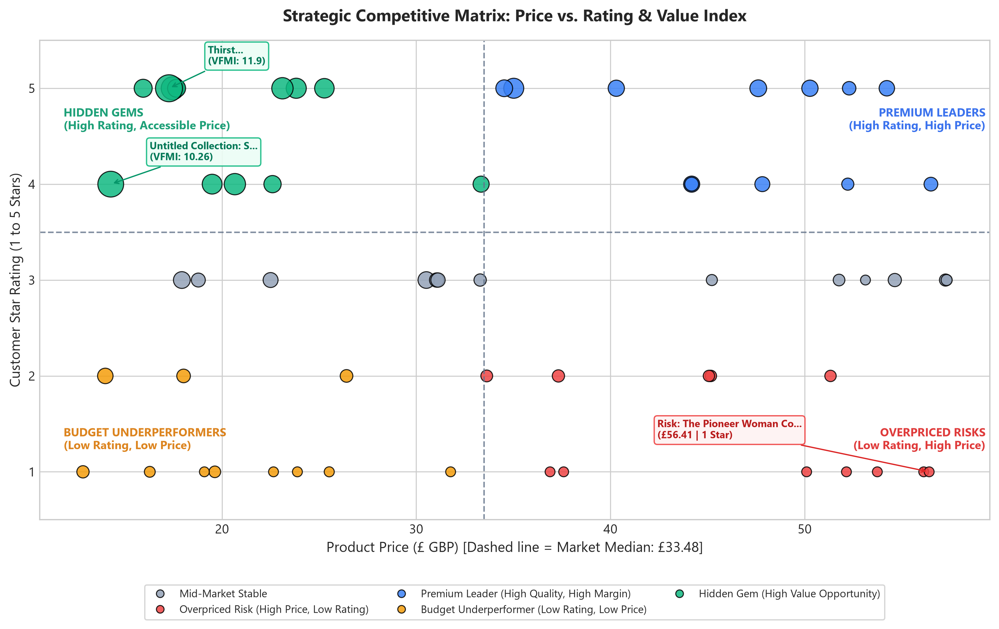
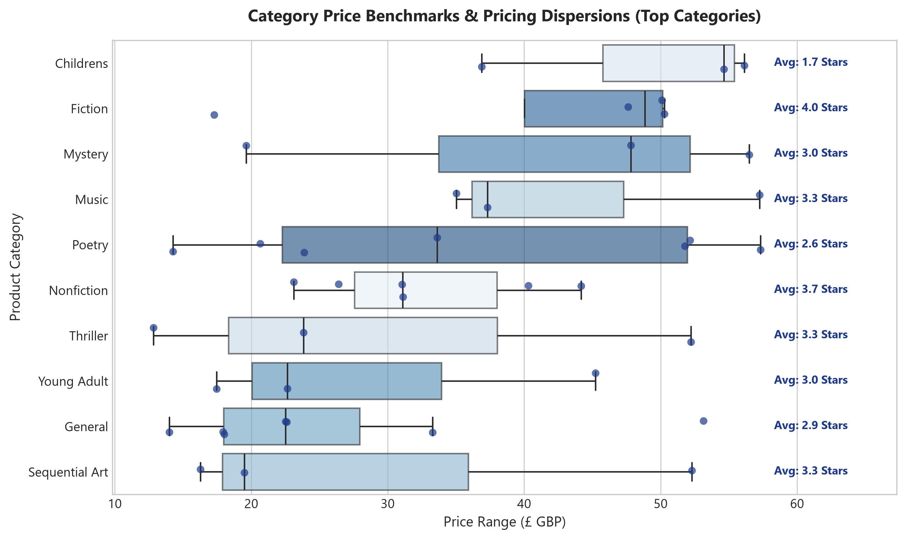
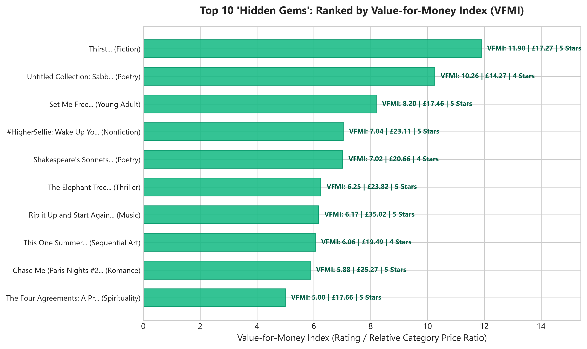
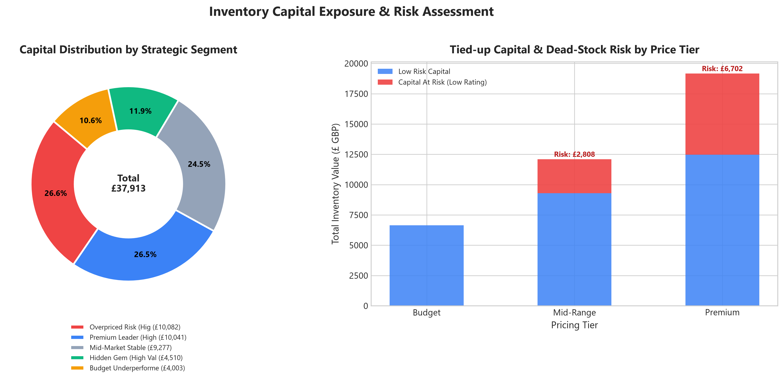

# E-commerce Price & Rating Intelligence System 📊
> **An End-to-End Competitive Market Analytics & Pricing Strategy Engine**

[](https://www.python.org/)
[](https://pandas.pydata.org/)
[](https://www.crummy.com/software/BeautifulSoup/)
[](https://seaborn.pydata.org/)
[](https://opensource.org/licenses/MIT)

---

## 📌 Executive Summary

In hyper-competitive retail environments, e-commerce brand managers face two costly risks:
1. **Dead-Stock & Margin Bleed:** Overpricing low-quality/low-rated SKUs, tying up critical working capital in inventory that fails to convert.
2. **Missed Market Expansion:** Failing to identify "Hidden Gems" (high-demand, top-rated products that are underpriced relative to category averages).

This project delivers an **autonomous market intelligence system** that scrapes real-world multi-page catalogs, computes dynamic competitive benchmarks, calculates a proprietary **Value-for-Money Index (VFMI)**, and generates executive-ready visual decision reports.

---

## 💼 Core Business Insights (Key Takeaways)

From an analysis of live product catalogs spanning **25 distinct retail categories** and **£37,912.99** in total inventory value:

| Business Metric | Market Benchmark | Strategic Takeaway |
| :--- | :---: | :--- |
| **Catalog Depth** | 60 Products / 25 Categories | Representative cross-sector retail sample |
| **Market Median Price** | **£33.48** | Realistic reference price for typical consumer conversions |
| **Market Average Price** | **£35.00** | Proximity to median (£1.52 gap) confirms balanced price elasticity |
| **Capital at Risk** | **£3,866.29** (~10.2% of stock) | Capital locked in low-rating (1–2★) overpriced products |
| **Market Star Rating** | **3.00 / 5.0** | Baseline consumer satisfaction benchmark |

### 🔍 Strategic Discoveries:
* **The "Hidden Gem" Advantage:** Identified 12 products achieving top-tier ratings (4★–5★) priced significantly below their category benchmark. 
  - *Example:* High-performing Fiction SKU priced at **£17.27** with **5.0★**, yielding a **VFMI of 11.90** (highest in the catalog).
* **Capital Risk Mitigation:** Products in the premium price band (£53.00+) with 1★ ratings tie up over **£1,074.80** in stagnant inventory. Recommendation: Immediate promotional markdown or clearance repackaging.

---

## 📈 Visual Intelligence Suite

All visualizations are autonomously rendered at **300 DPI** and exported to `reports/figures/`:

### 1. Strategic Competitive Matrix (The 4 Quadrants)
Maps every product by customer satisfaction vs price point, with bubble sizes proportional to customer Value-for-Money (VFMI):


### 2. Category Benchmark & Pricing Spread
Evaluates price dispersion and volatility across top product categories alongside sector average ratings:


### 3. Top 10 'Hidden Gems' (Ranked by VFMI)
Identifies the highest ROI candidates for marketing ad-spend and homepage feature placement:


### 4. Inventory Capital Exposure & Dead-Stock Risk
Quantifies working capital allocation across strategic quadrants and pinpoints capital exposure by pricing tier:


---

## 🧮 Mathematical Methodology & Formulas

### 1. Relative Price Positioning Ratio ($R_p$)
Measures whether an individual SKU is positioned as budget, market-neutral, or luxury relative to its direct category peers:
$$R_p = \frac{\text{Price}_{\text{SKU}}}{\overline{\text{Price}}_{\text{Category}}}$$

### 2. Value-for-Money Index (VFMI)
Formulated to quantify consumer perceived value by rewarding high ratings and penalizing category-relative price inflation:
$$\text{VFMI} = \frac{\text{Rating Score}}{R_p} = \frac{\text{Rating Score}}{\text{Price}_{\text{SKU}} / \overline{\text{Price}}_{\text{Category}}}$$

* **Interpretation:** A 5-star product priced 50% below its category average achieves a VFMI score of $10.0$, identifying it as an exceptional consumer bargain.

### 3. Four-Quadrant Strategic Segmentation

```
             High Rating (>= 4 Stars)
                       ▲
   HIDDEN GEMS         │    PREMIUM LEADERS
   (Growth Opportunity)│    (High Margin Winners)
                       │
◄──────────────────────┼──────────────────────►
  Below Median Price   │   Above Median Price
                       │
   BUDGET TRAPS        │    OVERPRICED RISKS
   (Low Quality/Price) │    (Immediate Markdown Needed)
                       ▼
             Low Rating (<= 2 Stars)
```

---

## 🏗️ Project Architecture

```text
ecommerce-price-rating-intelligence/
├── data/
│   ├── raw/                           # Raw ingested scraping dumps
│   │   └── ecommerce_data_raw.csv
│   └── processed/                     # Cleaned & feature-engineered dataset (32 features)
│       └── ecommerce_data_processed.csv
├── reports/
│   ├── figures/                       # Publication-grade 300-DPI visual reports
│   │   ├── 01_strategic_quadrant_matrix.png
│   │   ├── 02_category_price_spread_benchmarks.png
│   │   ├── 03_top_value_for_money_gems.png
│   │   └── 04_inventory_capital_at_risk.png
│   └── market_intelligence_summary.json # Machine-readable executive summary KPIs
├── src/
│   ├── __init__.py
│   ├── scraper.py                     # Two-tier pagination crawler with rate limiting
│   ├── processor.py                   # Data cleaning, VFMI & strategic matrix engine
│   └── visualizer.py                  # High-DPI Seaborn/Matplotlib reporting suite
├── main.py                            # End-to-end master pipeline orchestrator
├── requirements.txt                   # Dependency specifications
├── .gitignore                         # Environment & cache hygiene
└── README.md                          # Executive Case Study
```

---

## 🚀 Quickstart & Reproduction

### Prerequisites
* Python 3.10+
* Git

### Installation
```bash
# 1. Clone the repository
git clone https://github.com/<your-username>/ecommerce-price-rating-intelligence.git
cd ecommerce-price-rating-intelligence

# 2. (Optional) Create virtual environment
python -m venv venv
# Windows:
venv\Scripts\activate
# Linux/macOS:
source venv/bin/activate

# 3. Install dependencies
pip install -r requirements.txt
```

### Running the Complete Pipeline
Execute the master pipeline with a single command:
```bash
python main.py
```

### Advanced CLI Options
```bash
# Force a fresh crawl of 10 catalogue pages (200 products) with polite rate-limiting
python main.py --scrape --pages 10 --delay 0.15

# Run scraper module independently
python src/scraper.py --pages 5 --output data/raw/custom_dump.csv

# Re-run processor & generate JSON executive brief
python src/processor.py

# Re-render visual charts only
python src/visualizer.py
```

---

## 👨‍💻 Tech Stack
* **Language:** Python
* **Web Scraping:** `requests`, `beautifulsoup4`, `urllib3`
* **Data Processing & Analytics:** `pandas`, `numpy`
* **Data Visualization:** `matplotlib`, `seaborn`
* **Output Formats:** CSV, JSON, High-Res PNG (300 DPI)

---

## 📄 License
This project is open-source and available under the [MIT License](LICENSE).
